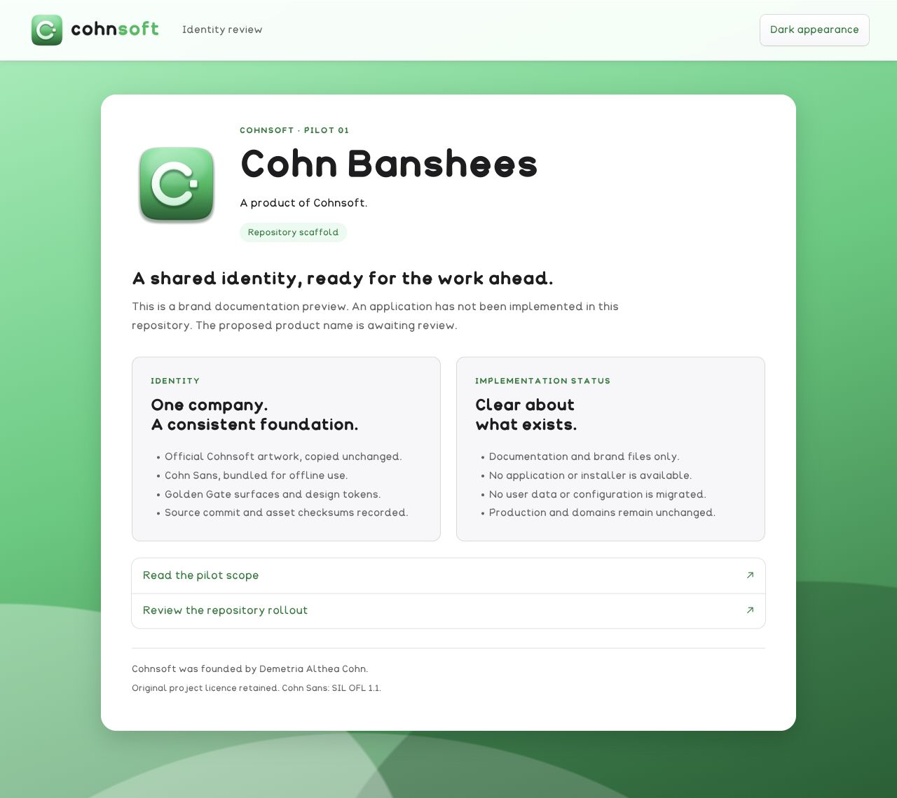
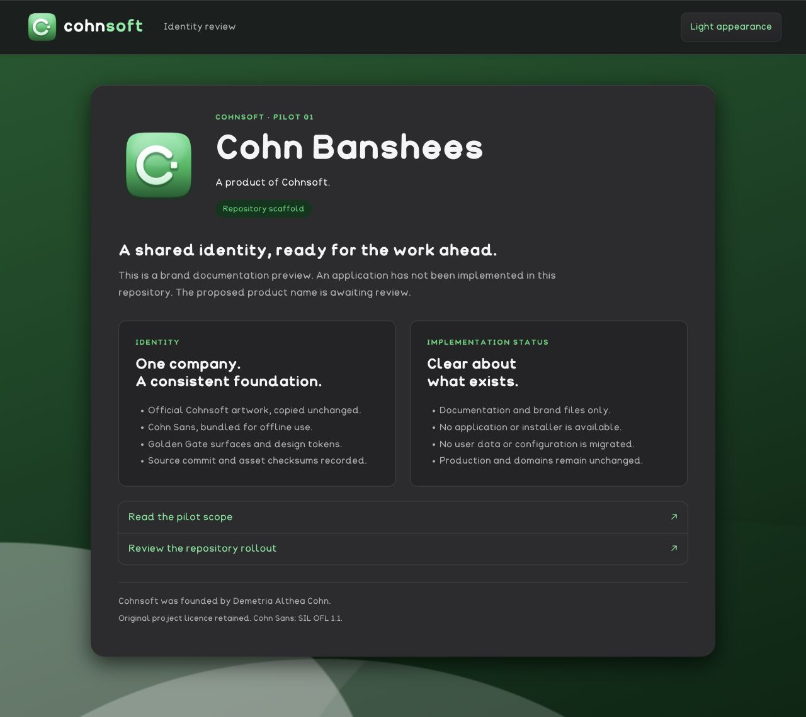

# Cohnsoft pilot: Cohn Banshees

## Inventory and plan

Baseline commit: `09418fc34f0f10828e60d6f03b3f1b54a0943e8a`. The repository contained only `README.md` (the heading `banshees`) and `LICENSE` (GPL-3.0). There were no application sources, package manifests, icons, old company credits, user data, API routes, deployment files, installers or tests. No applicable AGENTS.md was present.

Files in scope:

- `README.md`: proposed product name, exact company and founder credit, accurate implementation status, licence and preview instructions.
- `brand/product.json`: one source for the product identity and implementation status.
- `brand/cohnsoft/`: unmodified official artwork, platform icons, Cohn Sans, CSS, tokens and licences, pinned by commit and SHA-256.
- `tools/build-preview.mjs`, `docs/brand-preview-*`, `test/`: local documentation previews and integrity/offline-reference checks.
- `docs/COHNSOFT-ROLLOUT.md`: complete connected-repository inventory and proposed sequence, naming decisions and deferred domain migration.
- `.github/workflows/brand-checks.yml`: documentation build and integrity checks on PRs and the rebrand branch only. No deployment steps.

## Risks and choices

**Cohn Banshees is proposed, not approved.** This is the smallest product repository by GitHub-reported size (14 KiB at inventory time). The shared asset source is a reference repository, not a rebranding target. This pilot establishes a traceable brand foundation without inventing an application or implying it has been implemented.

The pinned asset guide says to retain legacy product identities; the user's explicit rebrand brief overrides that sentence. All other brand rules apply. Logos, wordmarks, icons, fonts, tokens and shared CSS are copied byte-for-byte. Product previews add a separate stylesheet with accessible Green 700/Green 400 text and a solid 3px focus outline; shared files are not edited.

The user permits future product-specific icons made with Cohn Sprite. Preserve editable `.asprite.json` source and use Cohnsoft's assets as immutable references. No new product icon is drawn in this scaffold pilot; its preview explicitly displays the official Cohnsoft app icon.

## Deliberately unchanged and migrations

The original `LICENSE` is unchanged (SHA-256 `3972dc9744f6499f0f9b2dbf76696f2ae7ad8af9b23dde66d6af86c9dfb36986`). The repository URL and main branch are unchanged. There are no existing product IDs, storage locations or user files to migrate. No migration code is invented for nonexistent data.

No production deployment, DNS change, secret update, release publication, repo rename or force-push is part of this PR. Existing public links remain as they were. The documentation previews do not contact external services.

## Validation

Commands and observed results are recorded below after execution. This repository has no application build, application test suite, installed product or desktop package. Consequently application screenshots, packaged launch, signing and notarization are not applicable to this pilot. The light/dark screenshots are **brand documentation previews**, not application screenshots. Future desktop rebrand PRs must meet the packaging, launch and codesign checks in the user's brief before being described as verified.

### Observed results

- `node tools/build-preview.mjs`: passed; generated both static documentation previews. This builds documentation only.
- `node --test test/*.test.mjs`: all 7 tests passed (asset SHA-256 integrity, exact product/credit strings, original/font licence preservation, local/offline dependency references, light/dark text contrast and focus declarations, honest scaffold status).
- Browser at default 1280px width: both themes rendered; local images loaded; computed body font is Cohn Sans. The appearance link navigated from light to dark. Keyboard Tab focused the skip link, whose computed outline width was 3px.
- Local HTTP requests loaded bundled CSS, fonts and images without external runtime dependencies.
- Original licence digest checked unchanged.
- No application build, desktop installers, packaged launch, codesign or notarization checks were possible: no such application exists in the baseline repository. No platform release is claimed.
- Screenshots below show documentation, not a completed application. The shared Cohnsoft asset repository and production were not modified.

### Light documentation preview

### Dark documentation preview

